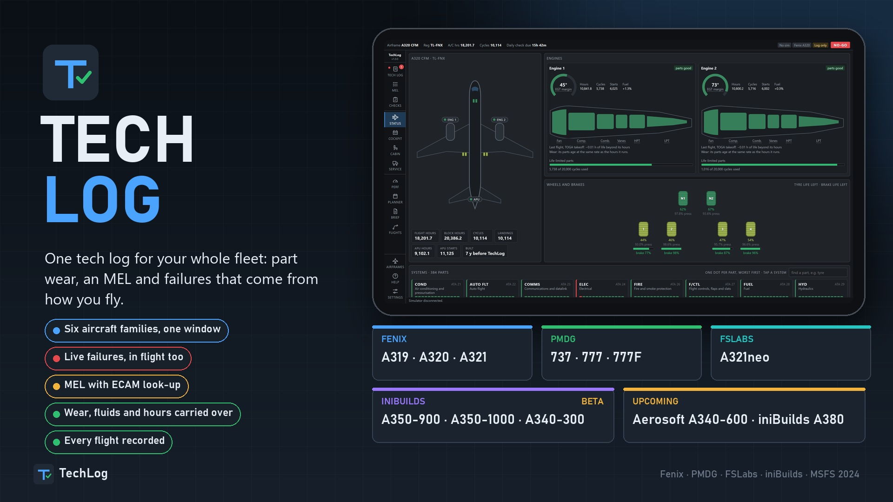

# TechLog

**One tech log for your whole fleet.** Part wear, a tech log with an MEL, failures from part condition and a record of every flight, for the Fenix, PMDG, FSLabs and iniBuilds airliners in Microsoft Flight Simulator 2024. Free.

TechLog keeps the record of each airframe from one session to the next. It sees which aircraft you load and runs that one. Things break because of how the aircraft has been flown and how long the part has been fitted, never by a dice roll.

## Download

**[Get the latest version](https://github.com/ersindevrim/TechLog-releases/releases/latest)**: download `TechLog-Setup-vX.Y.Z.exe` and run it with the simulator closed.

Also on [flightsim.to](https://flightsim.to/addon/118113/techlog).

## Aircraft

- Fenix A319, A320, A321
- PMDG 737 and 777
- FSLabs A321neo
- iniBuilds A350-900 and A350-1000 (beta)
- iniBuilds A340-300 (beta)

## You need

- Windows 10 or 11 (64-bit)
- Microsoft Flight Simulator 2024
- At least one of the aircraft above

## Install

1. Download the setup from the [latest release](https://github.com/ersindevrim/TechLog-releases/releases/latest) and run it.
2. If Windows SmartScreen appears, choose **More info**, then **Run anyway**. The installer is not code-signed.
3. Choose your aircraft. The setup brings in the airframes, flights and defects of Fenix TechLog, PMDG TechLog and FSL TechLog.

## Updating

TechLog tells you when a new version is out and can install it itself. To do that it reads the file `latest.json` from this page each time it starts. Nothing about you or your aircraft is sent, and it can be switched off in TechLog's settings.

## Bugs and ideas

Open an [issue](https://github.com/ersindevrim/TechLog-releases/issues) here, or comment on the flightsim.to page. A line from TechLog's Console or a screenshot helps a lot.

## Licence

TechLog is closed-source freeware: see [LICENSE.txt](LICENSE.txt). Please link to this page rather than re-uploading the file.

The MEL text is TechLog's own, written for simulation. Never use it for a real aircraft.
